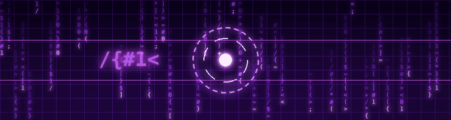

  

#

Olá, meu nome é Vitor Mengue Dorneles, tenho 19 anos e sou de Cachoeirinha - RS. Atualmente curso Ciência da Computação na Universidade Cesuca. Embora esteja iniciando minha trajetória na área de TI, tenho mais de 4 anos de experiência no mercado de trabalho em outras áreas, o que me trouxe responsabilidade, comprometimento e maturidade profissional. Sou apaixonado por tecnologia e especialmente curioso sobre Hardware, área na qual busco aprender e crescer.
 
#

<h3 align="left">🫂 Connect with me!</h3>

<h3 align="left">💻 My Stack </h3>

    

 
 

<h3 align="left">👨‍💻 GitHub Stats</h3>

<table align="center">
  <tr>
    <td align="center">
      
    <td align="center">
      
    </td>
  </tr>
</table>

<picture align="center">
  <source media="(prefers-color-scheme: dark)" srcset="https://raw.githubusercontent.com/menguevtr/menguevtr/output/github-contribution-grid-snake-dark.svg">
  <source media="(prefers-color-scheme: light)" srcset="https://raw.githubusercontent.com/menguevtr/menguevtr/output/github-contribution-grid-snake-dark.svg">
  
</picture>
